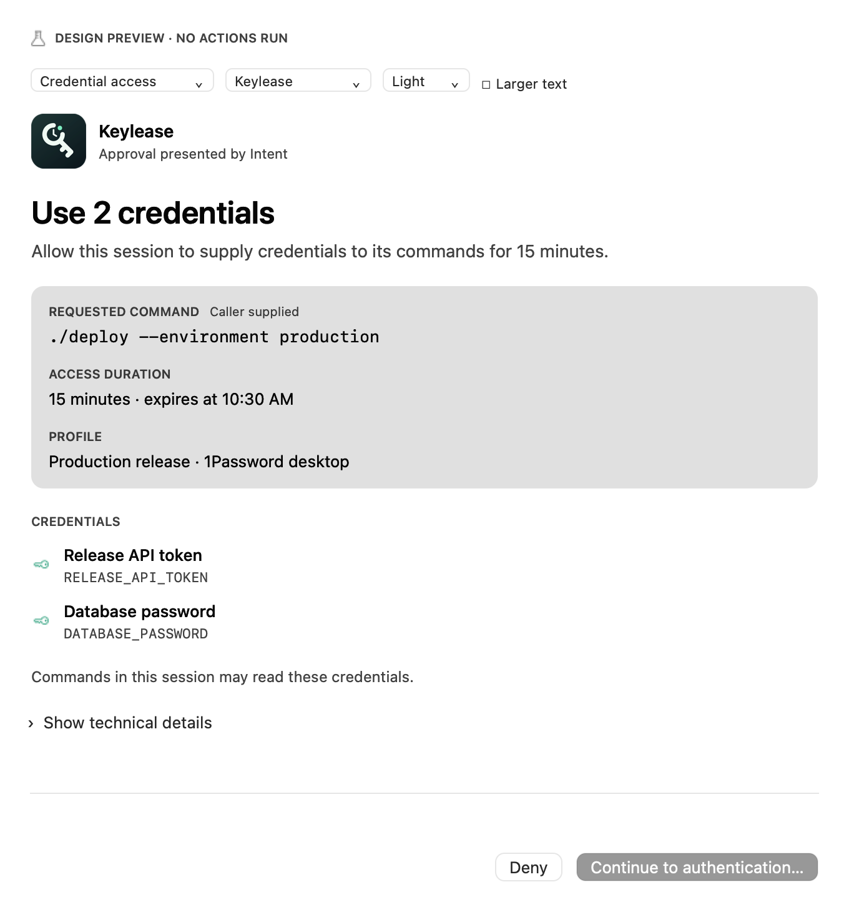
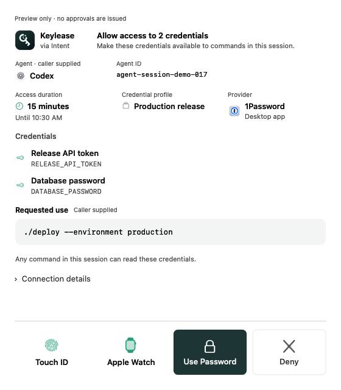

# Structured Mac approval preview

A standalone AppKit prototype for presenting structured approval content with application branding. The title and subtitle share a header row with application identity. The revised design separates preview settings from the approval, emphasizes the credential scope and expiry, and opens directly in a simulated authentication-waiting state. It remains separate from Intent's public SDK, production helper and SSH transport. No credential is read, no command runs, and no approval or authentication is issued. A fixed cue above the review always identifies it as a preview; the bottom section contains only authentication methods, password fallback, denial and their result.

## Run on a Mac

Requires macOS 13 or later and Xcode Command Line Tools. From the repository root:

```sh
python3 experiments/mac-review/preview.py
```

The script compiles `main.swift` into the ignored `.build/mac-review-preview` and opens the review. Use Preview options in the application menu or Command-comma to open a separate settings window: choose a normal, long or plaintext-file request; Keylease or example branding; light/dark appearance; larger text; and simulated available authentication methods. Availability belongs to the local authenticator and is never supplied by a caller's request. These settings simulate it without probing hardware or starting authentication.

## Authentication interaction

The review is already waiting when it appears. There is no Authenticate button to start the flow. Show Touch ID only when usable, Apple Watch only when usable, and both when both are usable. The prototype's local settings provide all four combinations, including password only. Available methods, Use Password and Deny share one row with centered icons and matching label typography. Method icons are larger, password and denial have larger hit targets, and repeated authentication instructions are omitted. Waiting methods are indicators; password and denial are buttons. Use Password remains visible in every case; Deny is always available during waiting.

Use Password opens an inert explanation of the macOS password prompt. There is no password field in this prototype. Closing that explanation resumes the simulated waiting state. Deny ends that state and disables its actions until a different sample or settings selection starts a new simulated request. Escape is assigned to Deny, Return to Use Password, Command-comma to settings, and Command-Q to exit. Keyboard, scrolling, selection, VoiceOver, focus and sheet interaction remain unverified because live testing was deferred.

The intended production interaction would begin OS policy evaluation once the immutable review is visible. Apple's [`deviceOwnerAuthentication`](https://developer.apple.com/documentation/localauthentication/lapolicy/deviceownerauthentication) policy supports Touch ID and Apple Watch in parallel, with user-password fallback. Password entry belongs to macOS. Actual capability detection, OS-owned authentication presentation and password-fallback handoff are future integration work; these exports demonstrate their intended presentation, not live hardware behavior. The production helper still uses its existing review-then-authenticate flow.

## Information architecture

| Structured input | Human presentation |
| --- | --- |
| Application name, icon/SF Symbol, identity and action accents | Compact application identity with Intent as presenter. Branding does not establish trust. |
| Action title and summary | The decision alongside the application identity, with matching title and subtitle sizes, spacing and top alignment. |
| Optional agent type and ID | A labeled caller-supplied requester row with an agent icon. The opaque ID remains selectable and wraps without truncation. |
| Typed access duration, expiry, profile and provider | Three labeled columns: Access duration, Credential profile and Provider. A profile names the credential collection; the provider identifies the app supplying it. |
| Credential names and environment mappings | What becomes accessible, without credential values. |
| Requested-use facts and caller-supplied flags | A subordinate command section with explicit provenance. The command is a claim, not a command restriction; any command in the session can extract the credentials. |
| Consequence | A prominent plaintext-file warning, including destination, readability and expiry behavior. |
| Supporting facts | Expandable connection details containing session metadata and the profile digest. |

The JSON files are prototype inputs, not a stable wire format. The root SDK and CLI now support agent identity separately; see [agent identity](../../README.md#agent-identity) for explicit library input, CLI inference and broker compatibility. `example-brand.json` changes the identity and palette while keeping layout, hierarchy and interaction consistent. Keylease's icon is copied from `lanej/keylease`'s `assets/icon/png/keylease-128.png`; colors follow its `assets/icon/design.json`. Codex and 1Password artwork is copied from their installed macOS application bundles. Harbor is fictitious. Prototype agent inputs accept an optional display `name`, an `icon` path to a bundled PNG or ICNS under `assets/`, and a fallback SF `symbol`; providers accept the same icon and symbol choices. Missing artwork falls back to a symbol. Known Codex agents use the bundled Codex icon by default. These artwork fields are preview-only; the public SDK agent identity remains type and ID. Authentication capabilities are local simulated state, deliberately excluded from these request fixtures.

## Render evidence

```sh
python3 experiments/mac-review/preview.py --capture /tmp/intent-review-captures
```

This renders ten native AppKit content-view bitmaps and exits. These are view exports, not desktop screenshots; window chrome and the separate settings window are excluded. Pixel density follows the rendering environment. Direct bitmap rendering preserves scroll clipping, avoiding the footer bleed observed with PDF exports. Custom AppKit drawing keeps prototype controls visible in exports; `NSButton` and `NSPopUpButton` retain native action, menu and accessibility behavior, which still needs live verification.

Normal captures use a 560×640 content viewport. The long-content export fits its document for inspection; `bounded-large.png` instead uses 520×580 and intentionally shows overflow with a fixed footer and scroll hint. Settings and approval remain separate; the fixed preview cue and method/password controls stay visible when the request scrolls.

| Variant | Artifact |
| --- | --- |
| Both methods, light | [View](screenshots/keylease-light.png) |
| Both methods, dark | [View](screenshots/keylease-dark.png) |
| Touch ID only | [View](screenshots/touch-id-only.png) |
| Apple Watch only | [View](screenshots/watch-only.png) |
| Password only | [View](screenshots/password-only.png) |
| Plaintext-file consequence | [View](screenshots/plaintext-light.png) |
| Connection details expanded | [View](screenshots/details-dark.png) |
| Long request with larger text | [View](screenshots/long-large.png) |
| Alternate application branding | [View](screenshots/application-brand.png) |
| Minimum viewport with long request and larger text | [View](screenshots/bounded-large.png) |

The exports were inspected for hierarchy, contrast, wrapping, viewport clipping and method visibility. Swift compilation, the repository `make check`, and independent review passed. These establish rendering and implementation evidence, not native authentication or approval of the design.

### Compare with the first prototype

The first version placed settings above the approval and required an extra Authenticate click. Its original render is preserved below; the revised view starts in the simulated waiting state, puts settings in a separate window and keeps password fallback visible.

| First prototype · 680×730 | Revised waiting state · 560×640 |
| --- | --- |
|  |  |
