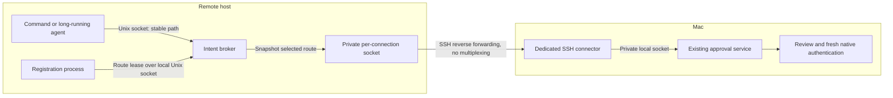

# Stable remote approval socket without ControlMaster

This is a review-only design and executable proof. It is outside `cmd/intent`, is not installed by `make install`, and does not change the current launcher, SSH configuration, Go API, or Keylease. It must not be treated as the completed replacement for dotfiles PR #310.

The remote broker owns one stable, private Unix socket. Each Mac connector owns a different reverse-forwarded transport socket and a dedicated ordinary SSH connection. Remote commands and long-running agents keep using the broker's stable path while connections come and go. Keylease continues to consume the Intent native SDK independently.



## Ownership and routing contract

- The remote broker owns `approval.sock`, `registration.sock`, and the broker lock inside an owner-only directory, for example `/home/you/.local/run/intent`. Its public socket is not replaced during transport handover. A broker restart may replace the socket inode but retains the configured path.
- Callers use `intent.NewClient(stableSocket)` or set `INTENT_APPROVAL_SOCKET` before starting their persistent process. No caller must rediscover an ephemeral path after reconnect. The proof uses the existing client API unchanged; stable-path default discovery is follow-up work.
- The broker is configured for one explicit Mac routing ID. That ID is not a secret or cryptographic authentication. Private directories and sockets exclude other user IDs; remote root and hostile same-user processes remain outside the isolation boundary. The broker must never describe that ID as proof of a machine's identity.
- A connector first asks the remote helper to allocate a private transport directory. It then starts a dedicated SSH connection with a reverse forward from that unique remote socket to its local approval service. The remote registration process checks the directory, session marker, socket and forwarding readiness before acknowledgment.
- The broker commits the last validated registration for the configured Mac as selected for new caller connections, before sending acknowledgment. That acknowledgment confirms the commit but may be lost; uncertain setup is not retried automatically. Each accepted caller snapshots one route. An already submitted request remains on its original transport during handover and is never replayed on the new connection.
- Every live registration, including a displaced route, retains exclusive ownership of its transport ID and endpoint. Duplicate ownership is rejected. Closing an old registration removes only its own route and endpoint. It cannot unregister a newer selection. If the selected transport disappears, new calls return `Unavailable`; the broker does not silently fall back to an older connection or a different Mac.
- Transport loss after submission closes the caller connection, preserving the existing `ErrOutcomeUnknown` contract. Cancellation propagates through the raw proxy and SSH forward to the existing approval service. A late native success cannot turn a disconnected request into an approval.
- Socket stability is not approval caching: each request retains a new request ID, caller deadline, explicit review and fresh authentication. No credentials, passwords or biometric data pass through this protocol.

The proof proxies the existing bounded approval protocol rather than introducing another request/response multiplexer. The broker has no approval authority: decisions still originate in the Mac service. Client-provided reasons remain unverified claims.

## Concrete connection sequence

1. Start the remote broker with its stable directory and configured Mac routing ID. The proof keeps this process in the foreground; production needs a user-service installation owned by Intent.
2. The Mac connector uses a short SSH preflight to allocate an existing Intent session endpoint with a random transport ID.
3. A second, dedicated SSH process creates `-R private-remote-socket:private-local-socket` and runs the remote registration command. Registration stays alive while this SSH process keeps its stdin open. Registration acknowledgment is observable on connector stdout.
4. Remote callers connect to the stable broker socket. The broker opens the selected private transport for each call, and bytes flow to the existing Mac approval service.
5. On disconnect, registration EOF withdraws only that transport. After opening the registration connection, the connector delegates validated endpoint cleanup to the broker; it does not delete an endpoint after an uncertain acknowledgment. Failed preflight cleanup is bounded; an SSH failure before registration can leave an owned temporary directory that needs conservative recovery.

OpenSSH supports [Unix-domain reverse forwarding](https://man.openbsd.org/ssh_config#RemoteForward) and [disabling connection sharing with `-S none`](https://man.openbsd.org/ssh#S). Every proof SSH invocation uses `-T -S none`, `ControlMaster=no`, `ControlPersist=no`, `PermitLocalCommand=no`, and `ForwardAgent=no`. Existing SSH key-agent forwarding is not repurposed. An explicit audited SSH configuration is required for this proof; the disposable fixture uses isolated keys and no user configuration. Preflight clears forwarding. The main invocation uses `ClearAllForwardings=no` because `yes` would erase even its explicit `-R`. Other forwards in the supplied config would also be used, so production config integration and forwarding policy need separate review.

## Run the proof

Build the experimental program on both Unix endpoints; consumers do not need Swift or a separate native app bundle:

```sh
go build -o /tmp/intent-socket-proof ./experiments/stable-socket
```

On the remote host, in a separate terminal:

```sh
/tmp/intent-socket-proof broker \
  --dir /home/you/.local/run/intent \
  --mac aaaaaaaaaaaaaaaaaaaaaaaaaaaaaaaa
```

On the Mac, with an explicit SSH config for `myhost` and the proof binary available at the supplied remote path:

```sh
/tmp/intent-socket-proof connect \
  --ssh-config /absolute/path/to/audited-ssh-config \
  --remote-binary /tmp/intent-socket-proof \
  --dir /home/you/.local/run/intent \
  --mac aaaaaaaaaaaaaaaaaaaaaaaaaaaaaaaa myhost
```

On the remote host:

```sh
INTENT_APPROVAL_SOCKET=/home/you/.local/run/intent/approval.sock \
  intent request --reason 'Review this harmless stable-socket test'
```

The normal proof binary uses the real native callback. Do not run that last request without a person available at the Mac. No native interaction was exercised for the automated evidence below.

## Observed evidence

```sh
GOTOOLCHAIN=go1.26.11 go test -race -count=1 -v ./experiments/stable-socket
INTENT_SSH_INTEGRATION=1 GOTOOLCHAIN=go1.26.11 \
  go test -race -count=1 -v ./experiments/stable-socket -run TestNoControlMasterOpenSSH
```

The disposable real OpenSSH check exercises approval, denial, handover with an old request already pending, old-route disconnect, selected-route loss, cancellation and unknown outcomes. It verifies that the stable socket inode stays unchanged. The fixture deliberately configures a master path and LocalCommand marker, then verifies neither is created: the connector's overrides disable both. Only the native authentication callback is synthetic, compiled into the test executable; the normal proof binary has no synthetic-approval flag.

The route-level check also rejects duplicate active or displaced endpoints and a different Mac ID and verifies selected-route loss never reactivates an older route. These checks establish the exercised loopback behavior, not compatibility with remote services, jump hosts, network partitions or human authentication methods.

## Before adopting this as the replacement

The proposed production shape is an Intent-owned remote user service and configured Mac connection profiles, with one background connector per selected target. Dotfiles would install/configure those profiles and service controls. Ordinary interactive SSH would need no multiplexing directives. Transport reconnection may be automatic; submitted approval requests must never be retried automatically.

The remaining work is service installation and recovery, explicit pairing changes, startup acknowledgment and observability, conservative cleanup after interrupted preflight, stable-path default discovery, and verified SSH-config/ProxyJump/authentication compatibility. Automatic wildcard-host onboarding is not implemented. Neither dotfiles PR #310 nor the project-update registration in #313 supplies these service controls today. Test the real native flow after a person confirms availability. Building or merging this proof does not install it globally or enable it automatically.
